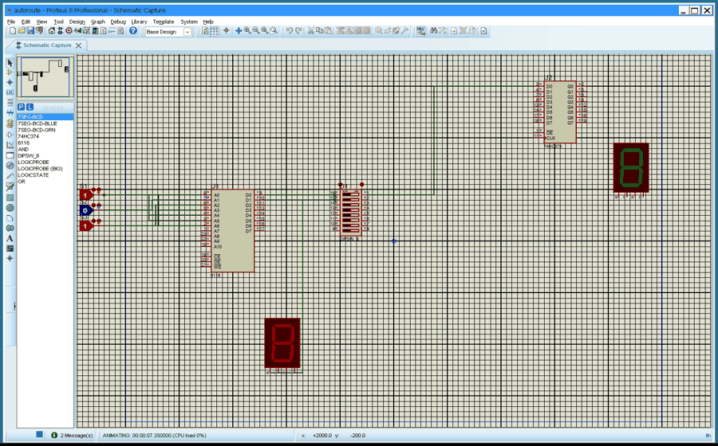

<h1 align="center">proteus2py</h1>

<p align="center">
  <b>Script Proteus 8 from Python and from AI assistants.</b><br>
  Headless circuit simulation with <i>Proteus's own engine</i>, Proteus's own graphs and screenshots, an MCP server.<br>
  Linux · sandboxed Wine · nothing keeps running between requests
</p>

<p align="center">
  <a href="https://github.com/DontforgetAntaiku/proteus2py/actions/workflows/ci.yml"></a>
  <a href="https://pypi.org/project/proteus2py/"></a>
  
  <a href="LICENSE"></a>
</p>

> **Requires your own licensed Proteus 8 Professional** (installed in a Wine prefix). proteus2py is an independent project, not affiliated with
> or endorsed by Labcenter Electronics, and ships no Proteus code, libraries or models: it drives the copy you already have.

<p align="center"></p>

## Why
Proteus is a capable simulator many universities teach with, but it has no scripting interface. proteus2py reverse-engineered the pieces that matter:

- **Real numbers, fast.** The engine behind Proteus's graph simulation (ProSPICE) is driven directly: ~2 s per run, no GUI. OP, transient, AC, DC sweep (nested),
  noise; SPICE decks or JSON circuits; 4000+ SPICE models and 37k device-library parts (BC547, 2N2222, 1N4007, TL072, LM324...).
- **Measurements.** -3 dB bandwidth, THD, rise time, expressions of probes (`db(v(out)/v(in))`, input impedance), parameter sweeps, Monte Carlo, plots.
- **Proteus's own pictures.** Open a real `.pdsprj`, run its graph, get the full-size Proteus graph as an image, or bridge it to numbers
  (`simulate_project` captures the netlist ISIS hands to ProSPICE and re-runs it headless).
- **AI-ready.** An MCP server lets an assistant build, simulate and measure circuits.
- **Safe.** Everything runs in a bubblewrap sandbox (no network, empty `$HOME`); the GUI (Xvfb + Wine + Proteus) exists only for the duration of one call.

## A 60-second tour
```bash
pip install proteus2py                      # or: uvx proteus2py-mcp
proteus2py setup ~/.wine-with-proteus       # once: copies a Wine prefix that has Proteus 8 into the sandbox (about 2 GB)
proteus2py doctor
proteus2py spice examples/rc_lowpass.cir    # -3 dB at 1000.09 Hz
```
```python
from proteus2py import sim, spice

spec = spice.parse(open("examples/ce_amplifier.cir").read())
r = sim.simulate(spec, "ce")                # Proteus's engine, headless
print(r["stats"]["v(c)"])                   # min / max / mean / rms
print(sim.measure_run("ce", "harmonics", "v(c)", f0=1000)["thd_pct"])
```

## MCP server
```json
{ "mcpServers": { "proteus": { "command": "uvx", "args": ["proteus2py-mcp"] } } }
```
Tools: `simulate`, `simulate_spice`, `measure`, `derive`, `sweep`, `monte_carlo`, `plot_run`, `search_models`, `model_text`, `simulate_project`, `gui_run`, `build_design`, ...
Full reference: [docs](docs/index.md) (mkdocs), [tool list](docs/tools.md), [example session](docs/transcript.md).

## Verified against theory
RC step response (0.03 %), RC -3 dB point (1000.09 Hz), resistor thermal noise (1e-4), BJT bias point and output characteristics, OP07 gain-11 amplifier (5.5002 V),
ideal transformer ratio, TL072/LM324 library macromodels, current/voltage-controlled sources, switches and behavioural sources.

## Limits
Linux only (Wine + bubblewrap). Digital/mixed-mode parts, microcontroller (VSM) models, `.INCLUDE` of host files and the distortion card are not supported yet.
Opening the GUI costs 15-40 s per call. `build_design` writes projects only for a small device set. Details: [docs/MCP.md](docs/MCP.md),
[docs/NOTES_prospice.md](docs/NOTES_prospice.md), [docs/PDSPRJ.md](docs/PDSPRJ.md).

## Contributing, license
[CONTRIBUTING.md](CONTRIBUTING.md) · [MIT](LICENSE). Proteus and ISIS are trademarks of Labcenter Electronics Ltd.
