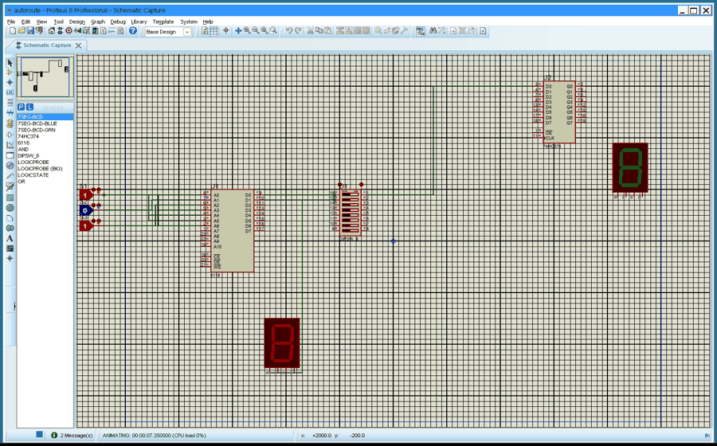

# proteus2py

Script **Proteus 8** from Python and from AI assistants. Headless circuit simulation with *Proteus's own engine* (ProSPICE), Proteus's
own graphs and screenshots, and an MCP server. Linux (sandboxed Wine) and Windows (experimental GUI driver).

* **Numbers, fast** - OP, transient, AC, DC sweep (nested), noise, distortion; SPICE decks or JSON circuits; digital gates; ~2 s per run, no GUI.
  See [Analyses](analyses.md).
* **Real library** - 4000+ SPICE models, 37k device-library parts (BC547, 2N2222, TL072 ...).
* **No GUI for projects** - `simulate_project_nogui` reads a real `.pdsprj` directly (components, nets, generators) and simulates it in ~2 s.
* **Pictures** - open a real `.pdsprj`, run its graph, get Proteus's own full-size graph; the GUI exists only for the duration of one call.
* **AI-ready** - [MCP server](tools.md) with typed results; see a [transcript](transcript.md).

You need your own licensed **Proteus 8 Professional**. Start with [Getting started](getting-started.md).
