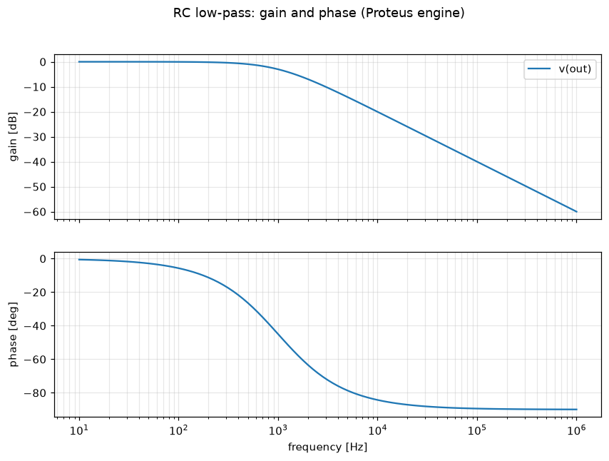
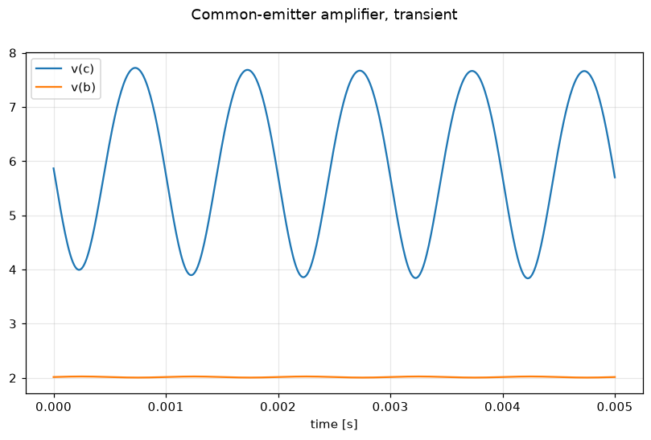
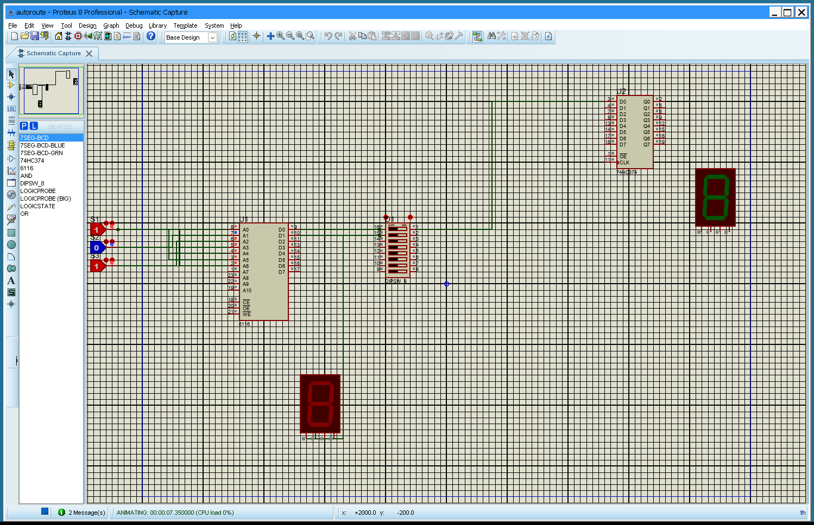

# An assistant session (MCP)

> **You:** Simulate an RC low-pass with R = 1 kOhm and C = 159.155 nF and tell me where the -3 dB point is.

The assistant calls `simulate_spice`:
```text
rc
V1 in 0 AC 1
R1 in out 1k
C1 out 0 159.155n
.ac dec 20 10 1meg
```
Result (typed `SimResult`): `analysis: ac`, `gain["v(out)"].f_high_3db = 1000.09`, no warnings. Then `plot_run` returns the figure:



> **You:** What happens to the bandwidth with 5 % resistors and 10 % capacitors?

`monte_carlo(spec, {"R1": "5%", "C1": "10%"}, {"what": "bandwidth", "probe": "v(out)", "field": "f_high_3db"}, runs=20)` ->
`mean = 1004 Hz, std = 38 Hz` (20 runs, 2 s each).

> **You:** Now a BC547 common-emitter stage, with distortion.

`simulate_spice` of [examples/ce_amplifier.cir](https://github.com/DontforgetAntaiku/proteus2py/blob/main/examples/ce_amplifier.cir), then
`measure(..., what="harmonics", probe="v(c)", f0=1000)` -> `thd_pct = 6.2` for 10 mV input (voltage gain about 200):



> **You:** Show me the same circuit in Proteus.

`build_design` writes a `.pdsprj` (supported devices only) and `gui_run` opens it, simulates and returns Proteus's own picture:


